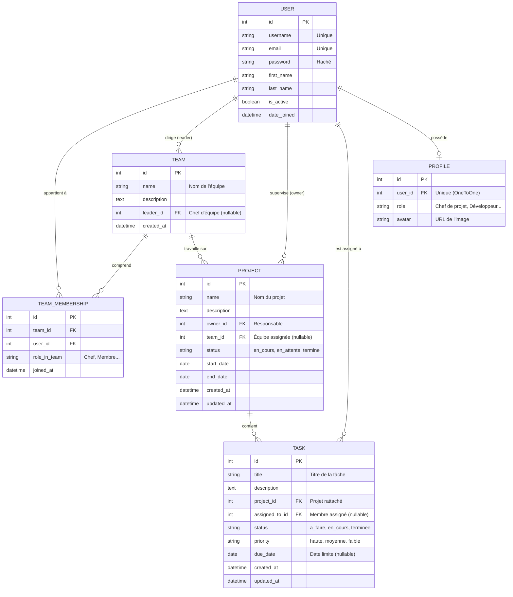

# Team Manager — Schéma & Architecture de la Base de Données

> **Document de coordination**  
> **Rédigé par** : Ariane (Coordination & Tableau de bord)  
> **Destinataires** : Elvado (Conception BD), Elvira (Modèles Django), Franc (API REST)

---

## 1. Schéma Entité-Relation (ERD)



---

## 2. Description Détaillée des Tables

### Table `users_profile` (Extension de `auth_user`)
Permet de stocker le rôle métier affiché dans l'application et l'avatar de l'utilisateur.

| Colonne | Type SQL | Contrainte | Description |
| :--- | :--- | :--- | :--- |
| `id` | `SERIAL / INT` | `PRIMARY KEY` | Identifiant unique du profil |
| `user_id` | `INT` | `UNIQUE, NOT NULL, FK(auth_user.id)` | Référence vers le compte Django |
| `role` | `VARCHAR(100)` | `NOT NULL, DEFAULT 'Développeur'` | Ex : *Project Manager*, *Designer*, *Développeur* |
| `avatar` | `VARCHAR(500)` | `NULLABLE` | URL vers la photo de profil |

---

### Table `users_team` (Équipes)
Gérée principalement par **Ornella** côté frontend.

| Colonne | Type SQL | Contrainte | Description |
| :--- | :--- | :--- | :--- |
| `id` | `SERIAL / INT` | `PRIMARY KEY` | Identifiant unique de l'équipe |
| `name` | `VARCHAR(150)` | `NOT NULL` | Ex : *Équipe Alpha*, *Équipe Beta* |
| `description` | `TEXT` | `NULLABLE` | Description ou objectif de l'équipe |
| `leader_id` | `INT` | `NULLABLE, FK(auth_user.id)` | Chef de l'équipe |
| `created_at` | `TIMESTAMP` | `NOT NULL, AUTO_NOW_ADD` | Date de création |

---

### Table `users_team_members` (Liaison Membres <-> Équipe)
Table Many-to-Many générée par Django pour associer plusieurs utilisateurs à plusieurs équipes.

| Colonne | Type SQL | Contrainte | Description |
| :--- | :--- | :--- | :--- |
| `id` | `SERIAL / INT` | `PRIMARY KEY` | Identifiant de la liaison |
| `team_id` | `INT` | `NOT NULL, FK(users_team.id)` | Référence de l'équipe |
| `user_id` | `INT` | `NOT NULL, FK(auth_user.id)` | Référence du collaborateur |

---

### Table `projects_project` (Projets)
Gérée principalement par **Daniel** côté frontend.

| Colonne | Type SQL | Contrainte | Description |
| :--- | :--- | :--- | :--- |
| `id` | `SERIAL / INT` | `PRIMARY KEY` | Identifiant unique du projet |
| `name` | `VARCHAR(200)` | `NOT NULL` | Ex : *Projet Alpha* |
| `description` | `TEXT` | `NULLABLE` | Présentation des objectifs |
| `owner_id` | `INT` | `NOT NULL, FK(auth_user.id)` | Responsable principal |
| `team_id` | `INT` | `NULLABLE, FK(users_team.id)` | Équipe affectée au projet |
| `status` | `VARCHAR(20)` | `NOT NULL, DEFAULT 'en_cours'` | Choix : `en_cours`, `en_attente`, `termine` |
| `start_date` | `DATE` | `NULLABLE` | Date de début du projet |
| `end_date` | `DATE` | `NULLABLE` | Date estimée de fin |
| `created_at` | `TIMESTAMP` | `NOT NULL, AUTO_NOW_ADD` | Date de création |
| `updated_at` | `TIMESTAMP` | `NOT NULL, AUTO_NOW` | Dernière mise à jour |

---

### Table `tasks_task` (Tâches)
Gérée par **Ornella** côté frontend et agrégée par **Ariane** dans le tableau de bord.

| Colonne | Type SQL | Contrainte | Description |
| :--- | :--- | :--- | :--- |
| `id` | `SERIAL / INT` | `PRIMARY KEY` | Identifiant unique de la tâche |
| `title` | `VARCHAR(200)` | `NOT NULL` | Titre court de l'action |
| `description` | `TEXT` | `NULLABLE` | Détails d'implémentation |
| `project_id` | `INT` | `NOT NULL, FK(projects_project.id)` | Projet auquel appartient la tâche |
| `assigned_to_id` | `INT` | `NULLABLE, FK(auth_user.id)` | Responsable de la tâche |
| `status` | `VARCHAR(20)` | `NOT NULL, DEFAULT 'a_faire'` | Choix : `a_faire`, `en_cours`, `terminee` |
| `priority` | `VARCHAR(20)` | `NOT NULL, DEFAULT 'moyenne'` | Choix : `haute`, `moyenne`, `faible` |
| `due_date` | `DATE` | `NULLABLE` | Date limite de rendu |
| `created_at` | `TIMESTAMP` | `NOT NULL, AUTO_NOW_ADD` | Date de création |
| `updated_at` | `TIMESTAMP` | `NOT NULL, AUTO_NOW` | Dernière mise à jour |

---

## 3. Guide de Construction (« Build »)

### Avec SQLite (Développement Local Rapide)
Le projet fonctionne immédiatement avec SQLite (`Backend/db.sqlite3`) :
```bash
cd Backend
python manage.py makemigrations
python manage.py migrate
python manage.py seed_dashboard
```

### Avec PostgreSQL (Environnement Final & Production)

1. **Création de la base de données** dans PostgreSQL :
   ```sql
   CREATE DATABASE devflow_db;
   CREATE USER devflow_user WITH PASSWORD 'mon_mot_de_passe_securise';
   GRANT ALL PRIVILEGES ON DATABASE devflow_db TO devflow_user;
   ```

2. **Configuration dans `Backend/config/settings.py`** :
   ```python
   import os

   DATABASES = {
       'default': {
           'ENGINE': 'django.db.backends.postgresql',
           'NAME': os.getenv('DB_NAME', 'devflow_db'),
           'USER': os.getenv('DB_USER', 'devflow_user'),
           'PASSWORD': os.getenv('DB_PASSWORD', 'mon_mot_de_passe_securise'),
           'HOST': os.getenv('DB_HOST', 'localhost'),
           'PORT': os.getenv('DB_PORT', '5432'),
       }
   }
   ```

3. **Application des migrations et injection des données de démo** :
   ```bash
   python manage.py migrate
   python manage.py seed_dashboard
   ```

---

## 4. Tests et Validation des Données

Pour s'assurer que les relations et les calculs statistiques fonctionnent correctement :
```bash
python manage.py test dashboard
```
Ce test valide l'étanchéité des données et vérifie qu'aucun utilisateur n'a accès aux tâches ou projets d'une autre équipe sans permission.
